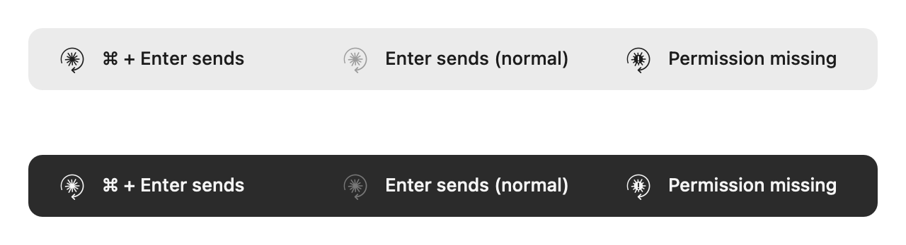

<p align="center">
  
</p>

<h1 align="center">ClaudeCmdEnter</h1>

<p align="center">
  <b>⌘ + Enter</b> to send. <b>Enter</b> for a new line.<br>
  A tiny menu bar helper for the Claude desktop app on Mac.
</p>

<p align="center">
  
  
  
  
  
</p>

<p align="center">
  
</p>

---

Ever sent a half-written prompt to Claude because you pressed Enter to start a new
line? ClaudeCmdEnter swaps the keys, but **only inside the Claude app**:

| You press | In Claude | Everywhere else |
|---|---|---|
| **Enter** | New line | Unchanged |
| **⌘ + Enter** | Send | Unchanged |
| Shift + Enter | New line (as before) | Unchanged |

It starts by itself when Claude opens, puts a small icon in the menu bar, and gets
out of the way when Claude quits. You keep opening Claude the usual way.

> [!NOTE]
> ClaudeCmdEnter is an independent, open-source project. It is not made by,
> affiliated with, or endorsed by Anthropic. "Claude" is a trademark of Anthropic.

## Features

- **Only in Claude.** Every other app keeps the normal Enter key.
- **Two switches in the menu bar.** Pick *⌘ Command + Enter to send* or *Enter to
  send* (Claude's normal keys). Turning one on turns the other off.
- **Follows Claude.** The menu bar icon appears when Claude opens and disappears
  when it quits.
- **Clear status.** The icon is dimmed in *Enter to send* mode and shows a small
  **!** when the Accessibility permission is missing.
- **Tiny and quiet.** About 7 MB of memory, 0% CPU when idle, under 1 MB on disk.
- **Private by design.** No network code, no key logging, no analytics.
  [Read exactly what it can see.](#privacy)
- **Universal.** One app for Intel and Apple Silicon Macs.
- **Small, readable code.** Plain Swift and AppKit, no dependencies, about 670
  lines with comments.

## Install

### Requirements

- macOS 12 Monterey or later
- Apple's free Command Line Tools (to build the app). Full Xcode is **not** needed.
  If you don't have them:

  ```bash
  xcode-select --install
  ```

### Build and install

```bash
git clone https://github.com/BPDRED/claude-cmd-enter.git
cd claude-cmd-enter
./install.sh
```

`install.sh` builds the app, copies it to `~/Applications/ClaudeCmdEnter.app`, and
adds a small start-at-login file (`~/Library/LaunchAgents/local.claudecmdenter.plist`).
macOS may show a *"Background Items Added"* notification: that's this file.

### Allow Accessibility (once)

macOS doesn't let any app change key presses without your OK:

1. Open **System Settings → Privacy & Security → Accessibility**.
2. Turn on **ClaudeCmdEnter**. If it isn't in the list, click **+**, press
   **⌘ + Shift + G**, type `~/Applications`, and choose **ClaudeCmdEnter**.

That's the only permission. Input Monitoring is not needed. The helper notices the
change after about 2 seconds, without a restart.

> [!TIP]
> Why build it yourself instead of downloading an app? The app isn't signed with a
> paid Apple developer account, so macOS would block a downloaded copy. Building it
> takes about a minute, and you get exactly the code you can read here.

## How to use it

Open Claude. The icon appears in the menu bar. Click it:

| Menu item | What it does |
|---|---|
| **⌘ Command + Enter to send** | Enter adds a new line, ⌘ + Enter sends |
| **Enter to send** | Claude's normal keys. The helper stops touching the keyboard |
| **Accessibility** | Green icon: permission granted. Grey: missing |
| **Open Accessibility Settings…** | Opens the right page in System Settings |
| **Quit ClaudeCmdEnter** (⌘Q) | Stops the helper until your next login |

Your choice is remembered.

> [!TIP]
> Because ⌘ + Enter arrives in Claude as a normal Enter, use **⌘ + Enter** anywhere
> in Claude you need a plain Enter, for example to confirm a dialog.

## Privacy

To change a key press, an app needs macOS's Accessibility permission. While it is
listening, macOS hands it every key press, in every app. There is no way to ask
for "only Enter in Claude". So here is exactly what ClaudeCmdEnter does with them:

- It checks one thing: *is this Return/Enter, and is Claude the app in front?*
- If not, the key passes through untouched. It is not read further, stored or logged.
- If yes, it adds Shift (new line) or removes ⌘ (send). Nothing else.

What it never does:

- **No network.** The program has no network code at all.
- **No key logging.** No key is ever saved or printed.
- **No keyboard access at all** while Claude is closed or *Enter to send* is on.
  The keyboard hook only exists while Claude runs in ⌘ + Enter mode.
- **No changes to Claude.** `Claude.app` is never modified.
- It saves one setting: which send key you chose.

You can check all of this in [`Sources/main.swift`](Sources/main.swift). The
keyboard code is the `handle` function.

## Resource use

Measured on an Intel MacBook (macOS 15):

| | |
|---|---|
| Memory | about 7 MB |
| CPU | 0% when idle |
| App size | about 0.9 MB (most of it is the app icon) |
| Network connections | none |
| Threads | 3 |

## FAQ

<details>
<summary><b>The menu bar icon doesn't show up.</b></summary>

The icon only shows while Claude is open. If Claude is open and you still don't see
it, restart the helper:

```bash
launchctl kickstart -k gui/$UID/local.claudecmdenter
```

On a MacBook with a notch, a full menu bar can hide icons. Try closing a few other
menu bar apps.
</details>

<details>
<summary><b>The permission is on, but the keys don't change (or the icon shows a "!").</b></summary>

This usually happens after a rebuild: each build gets a new local signature, and
macOS treats it as a new app. In **System Settings → Privacy & Security →
Accessibility**, select ClaudeCmdEnter, click **–**, then add it again with **+**
and turn it on.
</details>

<details>
<summary><b>System Settings shows a blank icon for ClaudeCmdEnter.</b></summary>

macOS sometimes caches an old icon. Quit System Settings (⌘Q) and open it again.
If it's still blank, remove the entry with **–** and add it again.
</details>

<details>
<summary><b>Does it work with Claude in the browser, or other apps?</b></summary>

No. It only changes keys in the Claude desktop app
(`com.anthropic.claudefordesktop`). Browsers and every other app are left alone.
</details>

<details>
<summary><b>Does it run all the time?</b></summary>

A tiny process starts at login and sleeps until macOS tells it that Claude has
opened. That costs about 0% CPU and a few MB of memory. It has no keyboard access
until Claude is open.
</details>

## Uninstall

```bash
./uninstall.sh
```

This stops the helper and removes the app and its start-at-login file. To also
forget the permission and the saved setting:

```bash
tccutil reset Accessibility local.claudecmdenter
defaults delete local.claudecmdenter
```

## Project layout

| Path | What it is |
|---|---|
| `Sources/main.swift` | Watches for Claude, the keyboard hook, the menu |
| `Sources/Icons.swift` | Menu bar and menu icons, drawn in code |
| `Sources/MenuRows.swift` | The switch rows and the Accessibility row |
| `Resources/Info.plist` | App name and settings (no Dock icon) |
| `tools/make_icon.swift` | Draws the app icon at build time |
| `build.sh` / `install.sh` / `uninstall.sh` | Build, install, remove |
| [`docs/INSTALL.md`](docs/INSTALL.md) | The full, step-by-step guide |

Issues and pull requests are welcome.

## License

[MIT](LICENSE)
